# Architecture

Forage is a single-module Android app (`app`, package `me.dougals.forage`): Kotlin, Jetpack Compose, Hilt, Room.
Diagrams are Mermaid sources in [`diagrams/`](diagrams); regenerate the SVGs with `diagrams/render.sh`.

## Layers

- Dependencies point inward: `ui` and `presentation` use `domain` interfaces only, and `data` implements them. Neither `ui`
  nor `presentation` imports `data`, and `domain` imports nothing from the other layers or from Android.
  Only `di` (Hilt) knows the concrete classes.
- Examples of interfaces implemented in `data`: `SessionStore` (`PrefsSessionStore`), `CredentialStore`,
  `NextcloudLoginFlow` (`OkHttpNextcloudLoginFlow`) and `OpmlExchange` (`OpmlTransfer`).
- `ui/WebUrl.kt` and `ui/Links.kt` are small UI helpers (`isWebUrl`, the Nextcloud News link).

## Repositories

Room is the source of truth for the UI: every `observe*` call reads from it. `ModeAwareFeedRepository` is the only
`FeedRepository` the app injects. It reads through `LocalFeedRepository`, and sends writes and `refresh()` to the
implementation chosen by the current `SyncMode` (`LOCAL` or `NEXTCLOUD`). Both extend `RoomFeedRepository`, which holds the shared
read and state-change logic. See [sync](sync.md) for the Nextcloud path and [ADR 0001](adr/0001-room-as-source-of-truth.md).

**Local refresh** (`LocalFeedRepository.refresh`): fetch each feed through `FeedFetcher`, parse it with `FeedParser`,
and insert new articles with `insertIgnore` (unique on `feedId, guid`). One failing feed does not stop the others;
the first error is returned at the end.

## Data model

`ForageDatabase` is at version 2 (`MIGRATION_1_2` adds `articles.imageUrl`). Exported schemas are in
`app/schemas/`. `remoteId` columns hold Nextcloud ids and stay null for items that exist only locally.

## Background work

`WorkManagerSchedulers` (in `data/work/Workers.kt`) schedules three workers, all requiring a network connection:

| Worker | Trigger | Does |
| --- | --- | --- |
| `RefreshWorker` | periodic (1, 3, 6 or 12 hours, or off), applied from the settings by `ForageApp` | `FeedRepository.refresh()` for the current mode; gives up after three attempts until the next period |
| `FlushWorker` | after a Nextcloud-mode read or saved change | pushes `pending_changes` |
| `ArchiveWorker` | when an article is saved | caches a cleaned copy of the page (`OfflineArchiver`); up to 5 attempts |

### New-article digest

After a background refresh, `RefreshWorker` gives the `SyncReport` to `NewArticleDigest`, which keeps the categories the user
opted into and builds one `DigestLine` per category (name, folder id, count, the feeds that gained articles, busiest
first, and the newest headlines across them). Both refresh paths fill `SyncReport.newHeadlines` with the newest
`HEADLINES_PER_FEED` (3) titles of each feed's new articles, so the report stays small even on a first Nextcloud pull, which
brings down the whole backlog. The notification quotes three headlines for a lone category and two each when categories share it. `DigestNotifier` is the domain interface; `AndroidDigestNotifier` implements it. Nothing is posted while the app is
visible or on the first Nextcloud pull, whose whole unread backlog would count as new.

Tapping the notification starts `MainActivity` (`singleTop`) with the folder ids in `EXTRA_DIGEST_FOLDERS`. The activity
turns them into a `FolderRequest` (`ui/FolderRequest.kt`), handled in two steps: `ForageNavScaffold` pops back to the
Unread list, then `ArticleListScreen` calls `ArticleListViewModel.selectFolders` and reports the request handled so it
is not applied again. Uncategorized feeds use `UNCATEGORISED_FOLDER_ID` (-1), the same id as the Unread list's chip.

## Dependency injection

`di/AppModule.kt` provides singletons. Two `OkHttpClient`s are qualified so credentials cannot leak across uses:
`@WebClient` (feeds and pages; adds the per-host session cookie) and `@ApiClient` (Nextcloud API and image fetching;
no cookie interceptor, and Nextcloud Basic auth is added only by the API provider). `ReaderEntryPoint` gives the reader
`WebViewClient`, which is not Hilt-managed, access to `ImageResourceFetcher`. See [security](security.md).

## Decisions

Recorded in [`adr/`](adr).
