# Security model

Feed content, OPML entries, article links and article HTML are untrusted. Rationale: [ADR 0002](adr/0002-guarded-http-and-reader-sandbox.md),
[ADR 0003](adr/0003-scoped-credentials.md).

## Outbound requests

`GuardedHttp` (`data/net/GuardedHttp.kt`) is used by `FeedFetcher`, `OkHttpPageFetcher` (offline archive) and
`ImageResourceFetcher` (reader images). Unless *Allow local network* is on:

- IP literals are checked before connecting; hostnames are checked after DNS resolution in `PublicOnlyDns`.
  Only globally routable unicast space passes (`isPublicAddress`).
- Redirects are followed manually (max 10) so each hop is checked. Proxies are disabled so the checked address is the one dialled.
- Response bodies are size-limited: 10 MB feeds, 5 MB pages, 15 MB images.

`ThumbnailFetcher` (list thumbnails) goes through `ImageResourceFetcher`, so it gets the same guard.

## Reader

`ReaderScreen` renders article HTML in a WebView with JavaScript and file access off, and the page carries a
Content-Security-Policy of `default-src 'none'` (images, inline styles and the bundled font only; `script-src 'none'`).
`shouldInterceptRequest` answers every http(s) subresource itself: bundled fonts from assets, images through
`ImageResourceFetcher`, everything else with 403. Link taps open in the external browser. The separate login WebView (`LoginScreen`) does enable JavaScript, since sites need it to sign in.

## Credentials

| Secret | Stored in | Sent to |
| --- | --- | --- |
| Nextcloud app password | app-private `SharedPreferences` (`CredentialStore`) | the configured Nextcloud host only, HTTPS only (`BasicAuthInterceptor`) |
| Site session cookies | app-private `SharedPreferences` (`SessionStore`), keyed by exact host | that exact host only, HTTPS only (`SessionCookieInterceptor`, a network interceptor so it runs per redirect hop) |

Cookies are captured from the in-app login WebView (`SessionCapture`). `@ApiClient` has no cookie interceptor, so
image fetches and Nextcloud calls never carry site cookies. `allowBackup` is `false`.

Secrets are not encrypted by the app: Jetpack's `EncryptedSharedPreferences` is deprecated, so they rely on Android's file-based
encryption and app sandbox (see [ADR 0003](adr/0003-scoped-credentials.md)). A rooted device or a debuggable build can read them.
