# Security model

Feed content, OPML entries, article links and article HTML are untrusted. Rationale: [ADR 0002](adr/0002-guarded-http-and-reader-sandbox.md),
[ADR 0003](adr/0003-scoped-credentials.md).

## Outbound requests

`GuardedHttp` (`data/net/GuardedHttp.kt`) is used by `FeedFetcher`, `OkHttpPageFetcher` (offline archive) and
`ImageResourceFetcher` (reader images). Unless *Allow local network* is on:

- IP literals are checked before connecting; hostnames are checked after DNS resolution in `PublicOnlyDns`.
  Only globally routable unicast space passes (`isPublicAddress`).
- Redirects are followed manually (max 10) so each hop is checked. Proxies are disabled so the checked address is the one dialled.
- Response bodies are size-limited: 10 MB feeds, 5 MB pages, 15 MB images. A caller can ask for extra statuses (only 304, for a conditional feed request that sent validators) to be handed to it instead of failing; every other
  non-2xx still throws, the address checks run first, and the validator headers go only to the original host, not to a redirect target.
  Each client also has a whole-call timeout
  (180 s for `@WebClient`, 240 s for `@ApiClient`), and a cancelled caller cancels the call, so a server that drips bytes cannot hold a request open.

`ThumbnailFetcher` (list thumbnails) goes through `ImageResourceFetcher`, so it gets the same guard.

Cleartext HTTP is refused app-wide by an explicit `network_security_config.xml` (`cleartextTrafficPermitted="false"`) referenced from the manifest,
rather than by the platform default. Error text shown to the user has web addresses replaced with `<link>` (`Throwable.toUiText`), and
`GuardedHttp` leaves URLs out of its own messages, since a feed URL can carry a token.

OPML import reads at most 10 MB, closes its stream, and walks nested folders iteratively, so a hostile file cannot exhaust memory or the call stack.

## Reader

Article HTML is sanitised with Jsoup's relaxed safelist in `ReaderViewModel` (off the main thread) and reaches the page only as a `SafeHtml`.
`ReaderScreen` renders it in a WebView with JavaScript and file access off, and the page carries a
Content-Security-Policy of `default-src 'none'` (images, inline styles and the bundled font only; `script-src 'none'`).
`shouldInterceptRequest` answers every http(s) subresource itself: bundled fonts from assets, images through
`ImageResourceFetcher`, everything else with 403. Link taps open in the external browser. The separate login WebView (`LoginScreen`) does enable JavaScript, since sites need it to sign in. Its top bar shows the host of the
current page as it navigates, and "Save session" refuses a page that is not HTTPS (`SessionCapture` enforces this too).

## Credentials

| Secret | Stored in | Sent to |
| --- | --- | --- |
| Nextcloud app password | app-private `SharedPreferences` (`CredentialStore`) | the configured Nextcloud host only, HTTPS only (`BasicAuthInterceptor`) |
| Site session cookies | app-private `SharedPreferences` (`SessionStore`), keyed by exact host | that exact host only, HTTPS only (`SessionCookieInterceptor`, a network interceptor so it runs per redirect hop) |

Cookies are captured from the in-app login WebView (`SessionCapture`). `@ApiClient` has no cookie interceptor, so
image fetches and Nextcloud calls never carry site cookies. `allowBackup` is `false`.

Secrets are not encrypted by the app itself: Jetpack's `EncryptedSharedPreferences` is deprecated, so they sit in app-private
storage, which Android encrypts at rest (file-based encryption) and other apps cannot read (see [ADR 0003](adr/0003-scoped-credentials.md)). A rooted device or a debuggable build can read them.
