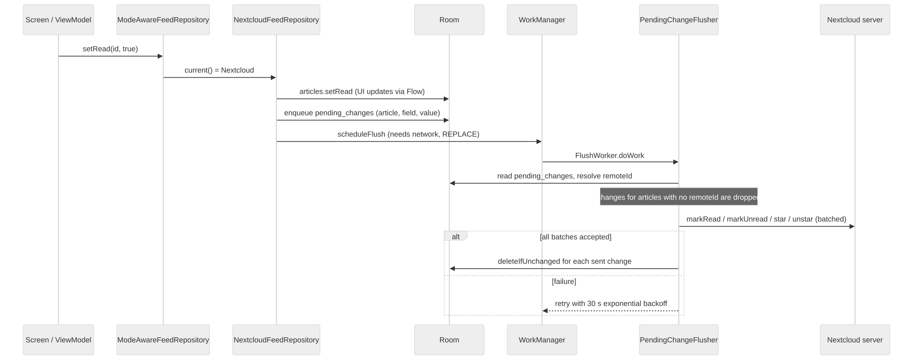
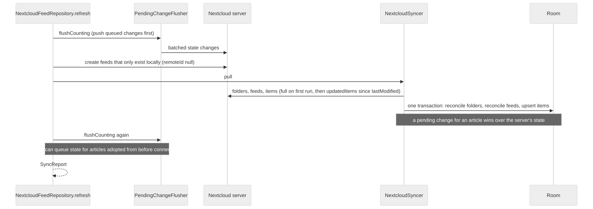

# Nextcloud sync

Nextcloud mode is selected by `SyncMode.NEXTCLOUD` in settings. Local state is always written first; the server
is brought into line afterwards. Room stays the source of truth ([ADR 0001](adr/0001-room-as-source-of-truth.md)).

## Which changes are queued

| Change | Path |
| --- | --- |
| Mark read/unread, save/unsave, mark feed read | Written to Room, then queued in `pending_changes` and flushed by WorkManager |
| Add/remove feed, create/delete folder, move feed | Sent to the server first; Room is updated only on success |

(`NextcloudFeedRepository`; a feed with no `remoteId` is moved locally only and created on the server in that folder at the next refresh.)

## Queued changes

`pending_changes` is keyed by `(articleId, field)`, so a newer change to the same field replaces the older one.
Rows are deleted only after the server accepts the batch, and only if unchanged since they were read
(`deleteIfUnchanged`), so a change made during a flush is kept. Retry backoff is exponential from 30 seconds;
`FlushWorker` gives up (`Result.failure`) if Nextcloud is not configured.

## Refresh

`NextcloudSyncer.pull()` applies the server state inside one Room transaction. The first pull fetches unread and starred
items; later pulls use `updatedItems` from the stored `lastModified`. Folders and feeds are matched by `remoteId`, then
by name (folders) or URL (feeds), which is how items added in local mode are adopted on connecting. For each article,
a field with a pending local change keeps its local value. Newly saved articles are scheduled for offline archiving.
